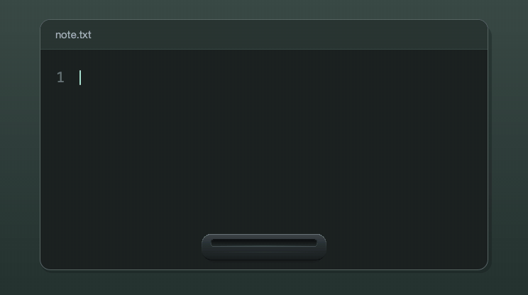

#  Key Balloons

[English](README.md) · [简体中文](README.zh.md) · [繁體中文](README.zh-TW.md) · [Français](README.fr.md) · [日本語](README.ja.md) · [한국어](README.ko.md) · [Español](README.es.md)

Key Balloons is a desktop overlay for macOS and Windows. As you type in any app, outlined key labels rise from a floating box and fade away in about two seconds. Each press creates its own animation, including repeated presses of the same key.

**[Download](https://github.com/boomsi/key-balloons/releases)** · [Install](#install) · [Use](#use) · [Build from source](#build-from-source) · [Integration guide](docs/mouse-feedback.md)



> Key Balloons uses keyboard input locally to display the animation. It keeps no keystroke history and sends no keystrokes over the network.

## Install

Download the installer for your platform from [GitHub Releases](https://github.com/boomsi/key-balloons/releases).

| Platform | Installation steps |
| --- | --- |
| macOS | Open the universal `.dmg`, drag **KeyBalloons.app** into Applications, and launch it from there. |
| Windows | Run the x64 `.exe` installer, then open **Key Balloons** from the Start menu. |

### Allow Input Monitoring on macOS

1. If Key Balloons needs permission at startup, choose **Open Input Monitoring** in the prompt. You can also choose **Enable monitoring…** from the menu bar later.
2. System Settings opens to **Privacy & Security → Input Monitoring**. Drag the **Key Balloons** icon from the card below the window into the list.
3. Turn on the switch in System Settings. The card closes once Key Balloons detects permission. If macOS asks you to quit and reopen the app, follow that prompt.

After an update, the switch can still show an authorization for an older build. Select the old entry, remove it with **−**, then drag the current app into the list and enable it again.

## Use

Type in your usual app. The box stays above it and displays one label per physical key press.

Left clicks, right clicks, and scrolling or pressing the wheel light the left, right, and center, respectively. Enable local mouse integrations under **Advanced** to [send or subscribe to mouse feedback](docs/mouse-feedback.md).

### Settings

Right-click the box or choose **Settings…** from the menu bar or system tray to open the same panel.

- Under **Appearance**, use **Size** (50%–150%) and **Opacity** (20%–100%) to adjust the box and floating labels.
- Under **Position**, enable **Allow dragging** to move the box with the left mouse button. **Snap box to screen bottom** moves it to the nearest screen's usable bottom edge when you release it.
- **Language** switches the interface immediately and remembers your choice. The default is English.
- The tray menu shows the app’s current memory use and monitoring status. Use it to pause or resume monitoring or quit.

On macOS 26, the settings panel uses a system Liquid Glass popover with native controls when built with Xcode 26 or later.
On macOS, the box stays at its chosen position across Spaces, and the animation follows it as part of the same floating group.

## Build from source

You need CMake 3.21 or later, the Qt 6.10 desktop SDK with Qt Quick, Qt Quick Test, and Qt Linguist tools, and either Xcode or the Visual Studio 2022 C++ toolchain. These examples use Qt 6.10.3.

### macOS

```sh
cmake -S . -B build \
  -DCMAKE_BUILD_TYPE=Release \
  -DKEY_BALLOONS_DEVELOPMENT_BUILD=ON \
  -DCMAKE_PREFIX_PATH="$HOME/Qt/6.10.3/macos"
cmake --build build --parallel
ctest --test-dir build --output-on-failure
open build/KeyBalloonsDev.app
```

### Windows (PowerShell)

```powershell
$qt = "$env:USERPROFILE/Qt/6.10.3/msvc2022_64"
$env:Path = "$qt/bin;$env:Path"
cmake -S . -B build -A x64 "-DCMAKE_PREFIX_PATH=$qt"
cmake --build build --config Release --parallel
ctest --test-dir build --build-config Release --output-on-failure
& "./build/Release/KeyBalloons.exe"
```

## Release installers

Publishing a GitHub Release starts **Release installers**. The workflow builds from the release tag, runs the tests, and attaches the universal macOS `.dmg` and Windows x64 `.exe` to the Release after both packages are verified.

Use **Actions → Release installers → Run workflow** to test packaging. Both installers appear under **Artifacts** for that run.

The macOS bundle uses ad hoc signing. Apple notarization and Windows release signing require credentials for the respective platforms.

## Project layout and tests

- [`examples/basic-box/`](examples/basic-box/) contains the built-in box example, its animations, and its mouse feedback subscriber.
- `src/macos/` and `src/windows/` handle keyboard events on their respective platforms. The macOS code also provides the native settings popover and the Input Monitoring guide.
- `tests/tst_balloons.qml` covers rapid input, independent expiry, dragging, mouse feedback, and settings. `tests/tst_overlay_core.cpp` covers screen placement, local integration, translation catalogs, and memory reporting.
- `tests/tst_stress.qml` simulates 20 inputs per second for 30 seconds and reports the 95th-percentile frame interval and time from label creation to the next Qt frame. Measuring physical key-to-display latency requires a separate test.

Use this command to run the sustained animation test on a desktop.

```sh
./build/key_balloons_tests -input tests/tst_stress.qml
```

On Windows, use `./build/Release/key_balloons_tests.exe`. For a quick end-to-end check, type `A A B` in TextEdit or Notepad. The editor should keep focus while the three labels rise and disappear independently.
