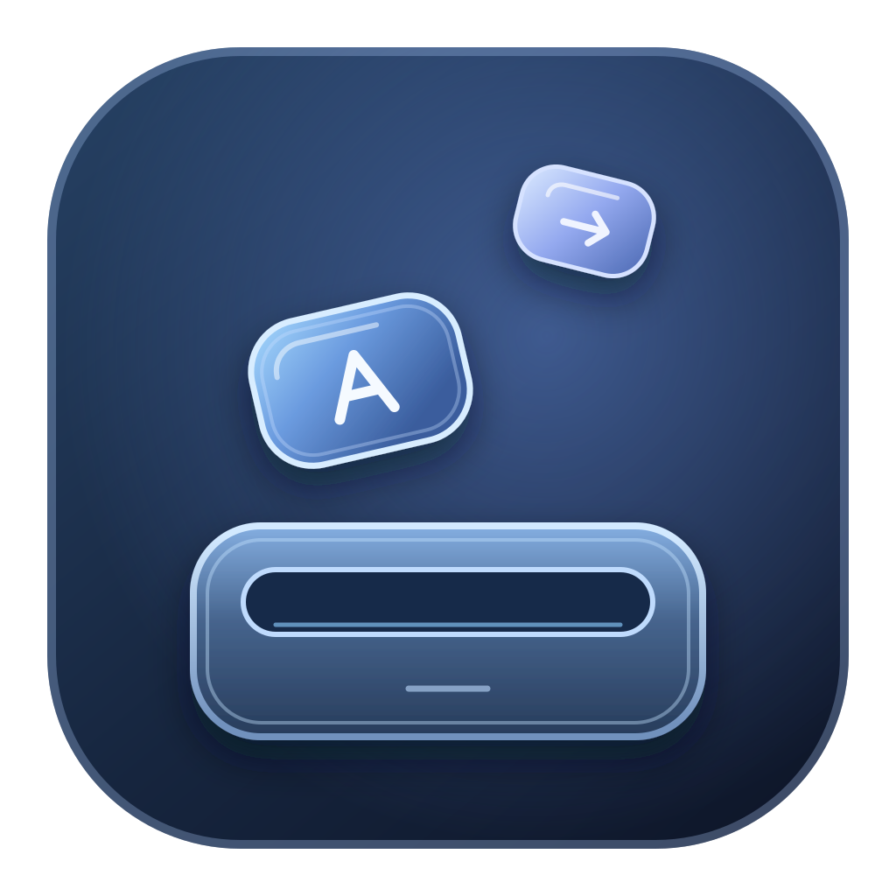

# Key Balloons

[English](README.md)



Key Balloons 是一个 macOS 和 Windows 的桌面小工具。在任何应用里打字时，带细描边的按键字符会从悬浮盒口弹出，约 2 秒后淡出。每次按键都会产生独立动画，连续按同一个键也会逐个显示。

键盘输入只在本机用来显示动画。应用不会保存按键记录或把按键发送到网络。

## 安装

从 [GitHub Releases](https://github.com/boomsi/key-balloons/releases) 下载对应的安装包。

- **macOS** 打开通用版 `.dmg`，把 **KeyBalloons.app** 拖进「应用程序」，再从那里启动。
- **Windows** 运行 x64 `.exe` 安装程序，从开始菜单打开 **Key Balloons**。

### 在 macOS 上开启输入监控

1. 从 Key Balloons 的菜单栏菜单选择 **Enable monitoring…**。
2. 系统会打开「隐私与安全性 → 输入监控」。把窗口下方卡片里的 **Key Balloons** 图标拖进列表。
3. 在系统设置里打开开关。应用检测到权限生效后会收起卡片。如果 macOS 提示退出并重新打开应用，按系统提示操作。

更新后，系统列表可能仍显示旧版的授权。先选中旧条目，点 **−** 移除，再拖入并开启新版。

## 使用

- 切到常用应用直接打字。盒子保持置顶，每次实际按键都显示一个字符。
- 左键按住盒子可以移动。右键在盒子侧边打开设置，用 **Allow dragging** 开关锁定或解锁位置。
- 用 **Opacity** 在 **20%–100%** 之间同时调节盒子和字符的透明度。
- 切到其他应用时，设置菜单会自动收起。从 macOS 菜单栏或 Windows 通知区域的图标可以暂停监听或退出。

使用 Xcode 26 或更新版本构建时，macOS 26 上的右键设置会用系统 Liquid Glass 弹出面板、原生开关和滑块。
在 macOS 上切换桌面时，盒子会留在原位置，动画跟着盒子一起显示。

## 从源码构建

需要 CMake 3.21 或更新版本、含 Qt Quick 和 Qt Quick Test 的 Qt 6.10 桌面 SDK，以及 Xcode 或 Visual Studio 2022 的 C++ 工具链。以下示例使用 Qt 6.10.3。

**macOS**

```sh
cmake -S . -B build -DCMAKE_BUILD_TYPE=Release -DCMAKE_PREFIX_PATH="$HOME/Qt/6.10.3/macos"
cmake --build build --parallel
ctest --test-dir build --output-on-failure
open build/KeyBalloons.app
```

**Windows（PowerShell）**

```powershell
$qt = "$env:USERPROFILE/Qt/6.10.3/msvc2022_64"
$env:Path = "$qt/bin;$env:Path"
cmake -S . -B build -A x64 "-DCMAKE_PREFIX_PATH=$qt"
cmake --build build --config Release --parallel
ctest --test-dir build --build-config Release --output-on-failure
& "./build/Release/KeyBalloons.exe"
```

## 发布安装包

发布 GitHub Release 会启动 **Release installers**。工作流从该 Release 的标签构建并运行测试。两端都验证通过后，macOS 通用版 `.dmg` 和 Windows x64 `.exe` 会附到同一个 Release。

在 **Actions → Release installers → Run workflow** 可以手动演练打包。两个安装包会出现在该次运行的 **Artifacts** 中。

macOS 包内的应用使用临时签名。Apple 公证和 Windows 发行签名需要各平台的发行凭据。

## 项目结构和测试

- `qml/` 包含共用的悬浮窗口和动画。
- `src/macos/` 和 `src/windows/` 分别处理各平台的键盘事件。macOS 模块还负责原生设置菜单和输入监控引导。
- `tests/tst_balloons.qml` 覆盖快速连敲、独立到期、拖动锁定、失焦收起和透明度。
- `tests/tst_stress.qml` 模拟每秒 20 次输入、持续 30 秒，输出帧间隔与字符创建到下一 Qt 帧的第 95 百分位。真实按键到显示的总延迟需要另行实测。

在桌面上可以运行持续动画测试。

```sh
./build/key_balloons_tests -input tests/tst_stress.qml
```

Windows 使用 `./build/Release/key_balloons_tests.exe`。也可以在 TextEdit 或记事本里敲 `A A B`，确认编辑器仍然有焦点，三个字符先后上升并独立消失。验证清单见 [TODO.md](TODO.md)。
